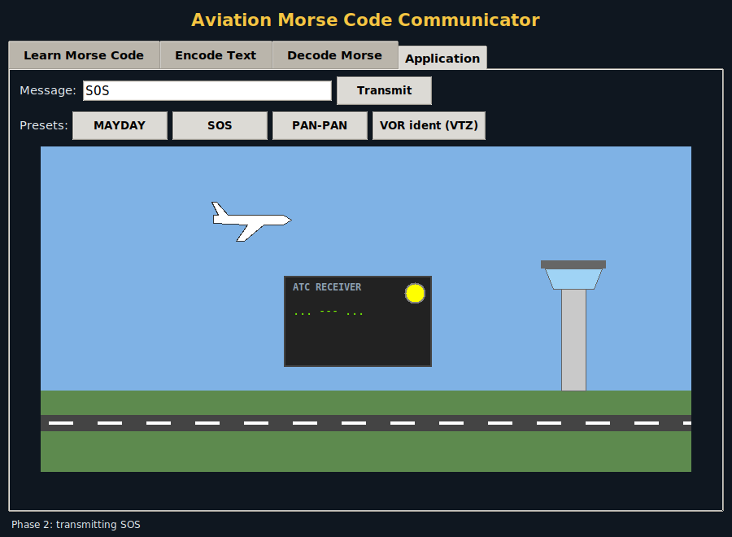
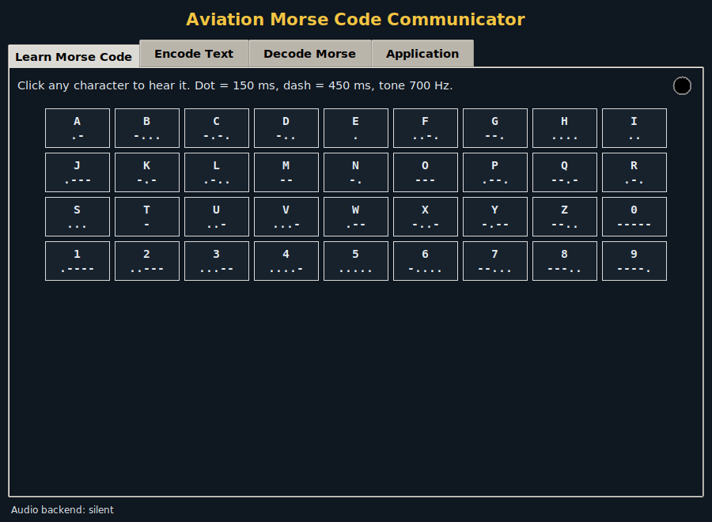
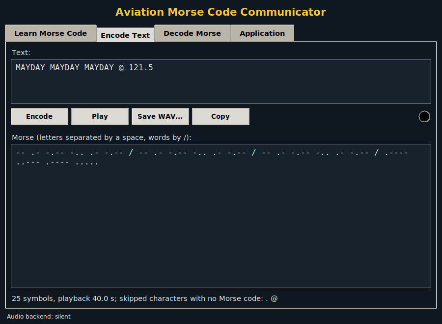
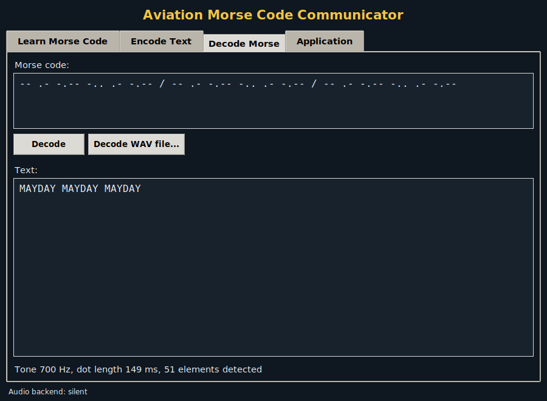
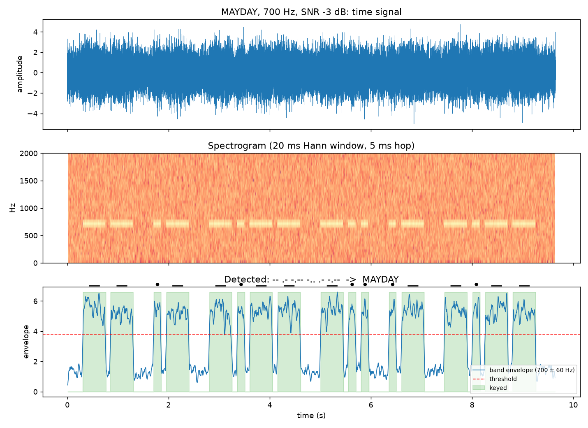

# Aviation Morse Code Communicator

**Learn, send and *hear* aviation Morse code, then let the computer decode it back from a noisy recording.**
A Python/Tkinter trainer with synchronised tone and signal lamp, an aircraft-to-ATC animation, and a DSP decoder that still reads Morse exactly at −6 dB SNR.


<p align="center">
  <br>
  <em>The Application view: an aircraft transmits MAYDAY to the tower while the lamp flashes in time with the 700 Hz tone.</em>
</p>

## Why

Pilots still confirm navigation beacons (VOR, NDB, ILS) by their Morse identifiers, and distress calls like SOS began as Morse. Learning it from a static chart is dull. This trainer lets you *see*, *hear* and *transmit* it. Its signal-processing core also does the reverse: it recognises Morse from audio, the way a radio operator does by ear.

## Features

| Section | What it does |
|---|---|
| **Learn** | A–Z and 0–9 chart. Click any symbol to hear it and watch the lamp |
| **Encode** | Text → Morse (letters split by spaces, words by `/`), play it, save as WAV, copy. Unsupported characters are skipped and listed |
| **Decode** | Morse → text (unknown symbols become `?`), or decode a **WAV recording** |
| **Application** | Three-phase animation: approach, transmit (ATC panel shows the code, lamp flashes), depart. Presets: MAYDAY, SOS, PAN-PAN, VOR ident |

| Learn | Encode | Decode (a noisy WAV) |
|---|---|---|
|  |  |  |

Under the hood, playback runs on a daemon thread and every widget update goes through `root.after()`, so the GUI never freezes. Audio uses `winsound` on Windows and PyAudio elsewhere, and falls back to silent timing if neither is available.

## Recognising Morse from audio



[`morse_app/dsp.py`](morse_app/dsp.py) implements the report's signal-processing section:

1. **Pre-emphasis** `y[n] = x[n] − 0.97 x[n−1]`, then normalise.
2. **Find the tone** from the spectrum peak (200–3000 Hz).
3. **Short-time spectrum** (20 ms Hann window, 5 ms hop). Take the energy in a ±60 Hz band around the tone and smooth it over 30 ms.
4. **Threshold with hysteresis**, then drop on/off runs shorter than 30 ms.
5. **Estimate sending speed** from the two tone-length clusters (dash ≈ 3 × dot).
6. **Classify** each run as dot or dash, and each gap as intra-letter, letter or word. Look up the text.

**How much noise can it take?** White noise, 5 messages × 20 noise seeds per point:

| SNR (dB) | 10 to −6 | −7 | −8 | −9 | −10 | −12 |
|---|---|---|---|---|---|---|
| Messages decoded exactly | **100 %** | 93 % | 75 % | 48 % | 20 % | 2 % |

The SNR is measured over the full 0–4 kHz band. The narrow tone band filter is what lets the decoder work below 0 dB.

## Timing (as in the report)

| Dot | Dash | Gap in letter | Gap between letters | Gap between words | Tone |
|---|---|---|---|---|---|
| 150 ms | 450 ms | 100 ms | 300 ms | 600 ms | 700 Hz |

## Repository layout

```
morse_app/   morse.py (dictionary, encode/decode, timing), audio.py (winsound/PyAudio/silent, threaded player),
             dsp.py (synthesis, recognition, WAV I/O), app.py (Tkinter GUI), __main__.py (CLI)
tests/       test_morse.py, test_dsp_audio.py (37 tests)
scripts/     snr_sweep.py
results/     snr_sweep.csv, figures/
samples/     sos_clean.wav, mayday_snr0.wav, vor_ident_vtz.wav
docs/        HOW_TO_RUN.md, screenshots/
report/      submitted report (PDF)
```

## Running it

Install, GUI, command line, tests and sound set-up: see **[docs/HOW_TO_RUN.md](docs/HOW_TO_RUN.md)**.

## Report

[`report/Aviation_Morse_Code_Communicator_Report.pdf`](report/Aviation_Morse_Code_Communicator_Report.pdf): the submitted report.

## Team

Signal Processing course project, School of Electronics Engineering (SENSE), VIT Vellore. Guide: Dr. Shweta B. Thomas.

| Name | Reg. No. |
|---|---|
| Arrnav Trisal | 24BVD0064 |
| Aditya Manoj | 24BVD0070 |
| Gavin Shalan Fernandes | 24BVD0083 |
| Jyothiraditya | 24BVD0205 |

## License

Released under the [MIT License](LICENSE).
